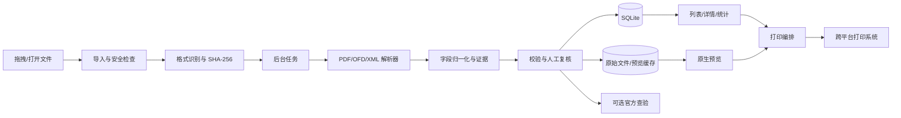

# 中国税务发票 GUI 工具：基础架构设计

## 1. 产品目标

制作一个跨平台桌面工具，优先支持 Windows，并保留 macOS/Linux 的构建能力。工具支持把发票文件拖入窗口后完成：

- 原文件归档、去重和分类；
- PDF、OFD、XML、图片的预览；
- 发票抬头、税号、发票号码、日期、价税合计、税额、明细等字段抽取；
- 单张、多张和按筛选条件汇总；
- 发票内容与抽取字段联动查看；
- 打印预览、选择打印机、份数、纸张、单双面和页码；
- 可选的税务发票查验；
- 全程本地处理，保留原文件和字段来源，便于复核。

产品定位是“发票资料管理、阅读和打印工具”。本地成功解析不代表发票真实有效，真伪状态必须由独立的查验流程产生。

## 2. 格式调研结论

### 2.1 不能把发票理解为一种固定文件格式

中国税务发票可能以纸质文件、PDF、OFD、XML、图片或包含附件的文件交付。实际可下载的格式取决于发票类型、开票系统和交付渠道。程序应根据文件内容识别格式，不能只根据扩展名判断。

| 格式 | 主要作用 | 适合做什么 | 主要限制 |
| --- | --- | --- | --- |
| PDF | 固定版式文档 | 预览、打印、人工阅读 | 可能只有图片；文本顺序和表格结构不可靠 |
| OFD | 中国电子文件版式文档 | 保持版式、打印、签章和附件处理 | 需要解析资源、字体、签章和版式；不能直接等同于结构化发票数据 |
| XML | 结构化电子发票数据 | 字段抽取、金额计算、系统交换和留档 | 人工阅读体验差；具体节点和版本需要按发票类型兼容 |
| PNG/JPEG/TIFF | 扫描件或截图 | OCR 和人工核对 | 无法仅靠图像确认真伪，识别结果必须带置信度 |

OFD 的基础国家标准是 **GB/T 33190-2016《电子文件存储与交换格式 版式文档》**。OFD 是版式容器，通常包含 XML、页面、字体、图片、资源和可能的签章信息。它解决“如何固定显示和交换”，并不取代税务系统中的结构化发票数据。

数电发票及部分电子发票交付中可能同时提供 OFD、PDF 和 XML。三者需要作为同一张业务发票的不同载体管理，而不是分别统计三次。建议使用以下关联规则：

1. 先用 XML 中的发票号码、开票日期、金额等标识建立关联；
2. 没有 XML 时，用解析出的发票号码、日期、价税合计和购销双方税号建立候选关联；
3. 关联不确定时保留人工确认，不自动合并；
4. 以原始文件 SHA-256 去重，以 `document_group_id` 作为同一张发票的逻辑归属。

### 2.2 字段来源需要分层

建议按可靠性和可追溯性分为四层：

1. **结构化层**：税务系统导出的 XML 或明确的电子发票数据，作为金额和字段的首选来源；
2. **版式文本层**：PDF/OFD 中可复制的文本和版式坐标；
3. **二维码层**：读取发票上的二维码，作为补充字段和查验入口；
4. **OCR 层**：后续对图片或扫描 PDF 接入 OCR；所有字段必须带置信度并支持人工修正。MVP 暂不内置 OCR。

每个字段都应保存 `source_type`、`source_file_id`、`confidence`、页面号和可选的坐标框。界面展示字段时可直接定位到原文位置，避免用户只看到一个无法解释的结果。

### 2.3 查验不能由 OCR 代替

发票查验应作为独立的适配器和状态机设计：

- `unknown`：尚未查验；
- `pending`：正在查验；
- `verified`：查验接口返回有效；
- `failed`：查验接口返回不通过；
- `expired`：超过查验时间窗口或凭证过期；
- `error`：网络、验证码、接口或参数错误。

查验结果需要保存查验时间、输入参数、返回摘要和原始响应摘要。正式实现前应核对国家税务总局全国增值税发票查验平台的最新规则、验证码和访问限制，不应把未经授权的网页自动化当成稳定接口。产品可以先提供“复制查验信息”和“打开官方查验页面”，再通过受支持的接口扩展。

## 3. 推荐技术方案

### 3.1 总体选择

采用 **C++17 + wxWidgets 3.2 + CMake** 的轻量级原生桌面架构：

- **wxWidgets**：负责窗口、拖拽、列表、表格、筛选、对话框和打印接口。它使用 Windows、macOS、GTK 的系统控件和绘制机制，不包含 WebView，也不需要 JavaScript 运行时；
- **C++ 单体进程**：导入、解析、统计、预览和打印都在同一个程序内完成，不引入 Java、Rust、Node.js、后台服务或解析侧车；
- **SQLite amalgamation**：直接编译进程序，保存发票索引、字段、统计和操作记录；
- **pugixml 或 tinyxml2**：解析 XML 和 OFD 内部 XML；
- **miniz**：读取 OFD 的 ZIP 容器，避免引入完整压缩包框架；
- **PDF 解析**：使用 MuPDF 静态库读取文本层和字符坐标，当前用于发票字段提取。MuPDF 闭源发行需要商业许可或遵守 AGPL，发布前必须确认授权方案；
- **OFD 适配器**：使用 C++ 直接读取 OFD 包，在程序内实现常用发票所需的页面、文字、图片和基础路径渲染。第一版明确支持范围，遇到签章、复杂渐变或特殊字体等不支持内容时提示人工复核，不引入 Java 解析器；
- **OCR**：第一阶段先不内置 OCR，优先支持 XML、可复制文本的 PDF/OFD。图片和扫描件后续再接入 ONNX Runtime 或 PaddleOCR，避免首版体积和部署复杂度膨胀。

wxWidgets 比 Qt 更适合当前的小工具定位：开发包、模块和运行时更小，直接提供文件拖放、数据视图、打印和跨平台窗口。它不是完全无成本，编译器和 PDF/OFD 渲染库仍然需要，但不会带来 Qt 全套 SDK 的负担。若最终只支持 Windows，进一步删掉 wxWidgets、直接使用 Win32 + SQLite 会更小；只要保留 macOS/Linux，wxWidgets 是更平衡的选择。

程序分为少量清晰模块：`app`、`ui`、`model`、`parser`、`render`、`storage`、`print`。界面线程只处理事件和可见内容，解析和渲染任务使用 wxWidgets 的工作线程；不额外拆分进程。

### 3.2 分层结构



### 3.3 解析流水线

每个导入任务按以下阶段运行，并记录阶段状态和错误：

1. **接收**：拖拽或文件选择，生成临时任务 ID；
2. **安全检查**：限制大小、页数、压缩包展开大小、路径穿越、恶意外部引用和脚本；
3. **识别**：读取 magic bytes、MIME 和扩展名，支持扩展名错误提示；
4. **归档**：计算 SHA-256，复制到应用数据目录，记录原始文件名和导入时间；
5. **解析**：在 C++ 工作线程中调用 PDF/OFD/XML 适配器，生成字段、明细、页面和证据；
6. **渲染**：生成统一的预览缓存；
7. **归一化**：统一日期、金额、税率、发票类型和字段别名；
8. **校验**：检查价税合计、明细合计、税额关系和必填字段，生成警告而不是静默修改原值；
9. **入库**：保存结果、置信度、错误和原文证据；
10. **展示**：列表可立即显示已完成的字段，耗时任务通过状态更新；
11. **人工复核**：用户修正的值与机器值同时保存，并记录修改时间和来源。

解析器接口建议保持稳定：

```text
probe(input) -> format, confidence
extract(input) -> normalized invoice + evidence + warnings
render(input, options) -> preview pages
validate(input) -> validation results
```

## 4. 领域模型

金额不能使用浮点数。建议使用十进制定点数，金额固定保存到分，税率使用十进制字符串或枚举；数据库中不要把金额存成浮点数。

核心对象如下：

```text
InvoiceDocument
  id
  document_group_id
  original_file_id
  detected_format: pdf | ofd | xml | image
  invoice_type
  invoice_number
  invoice_code              # 兼容有票种仍使用发票代码的情况
  issue_date
  buyer: Party
  seller: Party
  amounts: AmountSummary
  items: InvoiceItem[]
  qr_payload
  parse_status
  verification_status
  review_status
  created_at / updated_at

Party
  name
  tax_id
  address_phone
  bank_account

AmountSummary
  total_before_tax
  total_tax
  total_with_tax
  currency

InvoiceItem
  name
  specification
  unit
  quantity
  unit_price
  amount_before_tax
  tax_rate
  tax_amount
  discount_or_red_flag
  source_evidence

FieldEvidence
  field_path
  value
  source_type
  source_file_id
  page_number
  bounding_box
  confidence
  extractor_version
```

发票类型和税率不能只用一个固定的字符串覆盖所有情况。应允许专票、普票、数电票、机动车发票、通行费发票、红字发票、差额征税、免税和不征税等扩展，并保留原始标签。

## 5. 数据存储设计

建议使用 SQLite，原始文件和派生预览文件放在应用数据目录：

```text
app-data/
  database.sqlite
  originals/sha256-prefix/full-hash.ext
  previews/document-id/page-001.png
  rendered/document-id/print.pdf
  ocr/document-id/result.json
  logs/
```

首批表：

- `files`：原始文件、哈希、MIME、大小、路径、导入时间；
- `invoice_documents`：发票主体和当前归一化字段；
- `invoice_items`：明细行；
- `field_evidence`：字段来源、置信度和坐标；
- `document_relations`：同票的 PDF/OFD/XML 关联；
- `parse_runs`：解析器版本、耗时、结果和错误；
- `verification_runs`：查验输入、时间、结果摘要；
- `print_jobs`：打印机、页码、份数、参数和状态；
- `audit_events`：人工修改和重要操作。

导入后的原文件应当只读保存。用户删除记录时采用回收站或可恢复删除，清理原始文件前提示会影响预览、查验记录和审计信息。

## 6. 界面基础布局

建议使用三栏工作区：

- **左栏：发票集合**。支持拖入、导入进度、格式/日期/抬头/供应商筛选、解析状态和重复提示；
- **中栏：版式预览**。显示 PDF/OFD 渲染页，支持缩放、旋转、页码、原文定位和打印预览；
- **右栏：结构化信息**。显示抬头、税号、日期、金额、税额、查验状态和明细表，字段旁显示来源与置信度。

顶部提供跨发票统计：发票张数、价税合计、不含税金额、税额、红字冲减、按月份/供应商/发票类型分组。统计默认按 `document_group_id` 去重，并明确显示“已解析金额”和“待复核金额”，避免把未识别字段当成零。

## 7. 打印设计

当前实现采用“PDF 原样交给系统打印”，不把发票页面渲染成位图：

1. 用户多选发票，单张直接调用 Windows 系统 `print` 文件动词；
2. 多张 PDF（包括重复发票）先用 MuPDF 合并成一个临时 PDF，再调用一次系统 `print`；
3. 打印机、份数、纸张和方向由系统关联的 PDF 程序处理；
4. 临时合并文件放在应用数据目录的 `print-cache`，超过 24 小时的文件在后续打印时清理。

这条链路的优点是保留原始 PDF 的版式和文字质量，代码量小。限制是依赖用户机器上的 PDF 程序是否注册了可靠的 `print` 动词；`print` 使用系统默认打印机，无法由应用统一选择打印机、页码和份数。OFD/XML 暂不在打印链路内。

## 8. 安全、隐私和可靠性

发票包含企业税号、地址、电话、银行账户和交易信息。默认采用本地优先方案：

- OCR、解析、索引和统计默认不上传云端；
- 对外联网只用于用户主动发起的查验、更新或帮助页面；
- 解析压缩包时防止 Zip Slip、Zip Bomb 和超大资源；
- 预览器禁用不必要的脚本、外部网络加载和自动打开链接；
- 应用数据目录设置访问权限；
- 每个解析结果记录解析器和 OCR 版本；
- 对机器识别的低置信度字段要求人工复核；
- 日志中对税号、账号和地址做脱敏，原文只存本地文件。

金额校验只生成“通过、警告、失败、无法判断”，不要擅自改写原文件或替用户断言税务效力。数字签章、二维码和官方查验结果要保留原始证据。

## 9. 迭代路线

### 第一阶段：可用 MVP

- Windows 桌面壳、拖拽导入和文件列表；
- PDF 文本提取和发票字段解析；
- OFD 基础预览和文本抽取；
- XML 基础读取；
- 单张字段展示、明细和金额校验；
- SQLite 存储、原文件归档、SHA-256 去重；
- 统一预览和跨平台打印；

### 第二阶段：批量办公

- 批量导入和后台任务队列；
- 多格式同票关联；
- 按月、抬头、供应商和类型统计；
- 人工复核工作台和字段定位；
- 打印队列、批量打印和打印历史；
- 规则化导出 CSV/Excel/JSON。

### 第三阶段：税务辅助能力

- 二维码解析和查验信息填充；
- 连接受支持的官方查验流程；
- 图片和扫描 PDF 的 OCR；
- OFD 数字签章验证能力评估；
- 规则版本管理、红字发票关联和异常检测；
- 可选的加密备份和团队共享。

## 10. 第一版验收样本

实现前应准备脱敏样本集，而不是只用一张正常 PDF：

- 数电发票的 PDF、OFD、XML 三种文件；
- 增值税专用发票和普通发票；
- 红字发票、折扣行、差额征税、免税和不征税；
- 多页发票、长明细发票和带二维码发票；
- 只有扫描图像的 PDF、旋转图片、低清晰度图片；
- 文件扩展名错误、损坏文件、超大文件和重复文件；
- 同一张发票同时导入 PDF/OFD/XML 的关联场景；
- Windows、macOS 和 Linux 上的常见打印机与 A4/自定义纸张的打印结果。

验收重点是：原文预览与打印不变形；金额使用十进制定点数；同一张发票不重复统计；每个机器字段都能追溯到来源；解析失败可重试且不会丢失原文件。

## 11. 官方资料入口

实现阶段应以以下资料的最新版本核对具体字段、格式和查验规则：

- 国家标准：GB/T 33190-2016《电子文件存储与交换格式 版式文档》；
- 国家税务总局官网：https://www.chinatax.gov.cn/；
- 全国增值税发票查验平台：https://inv-veri.chinatax.gov.cn/；
- 国家税务总局关于全面数字化电子发票、电子发票服务平台和发票查验的最新公告及操作指引；
- 相关电子凭证会计数据标准、电子发票版式文件和开票系统接口文档。

公告和平台规则会调整。特别是 XML 节点、OFD 版式版本、查验限制和数字签章验证规则，应在编码前用真实的脱敏样本及当前官方资料再次确认。
